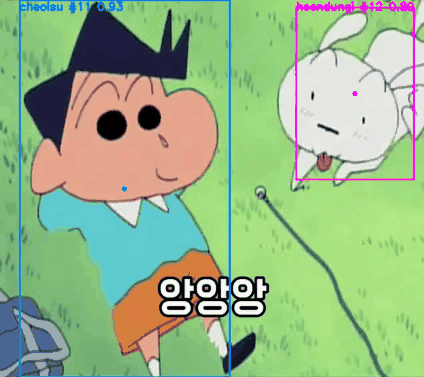
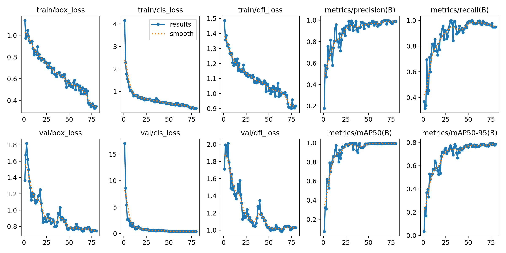
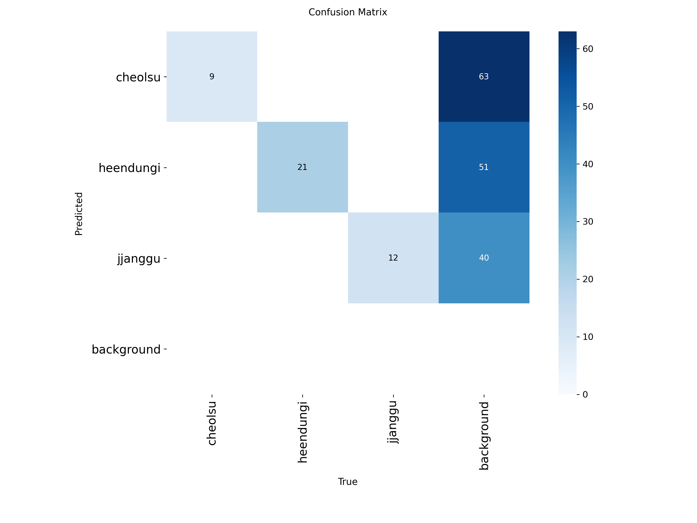
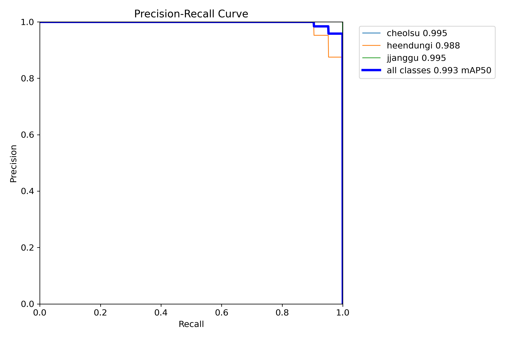
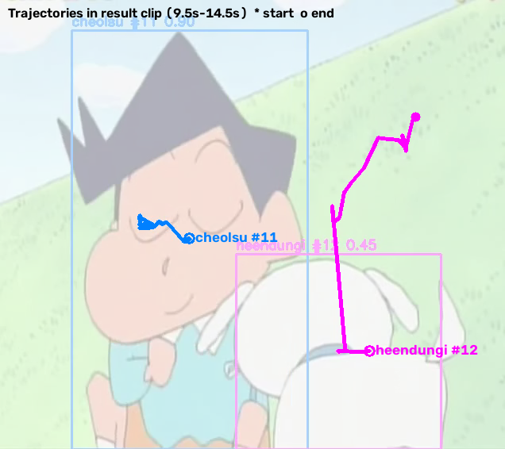

# 짱구 · 흰둥이 · 철수 객체 감지 및 추적 (YOLOv8 Fine-tuning)

머신러닝 과제: 애니메이션 「짱구는 못말려」의 캐릭터 3종(**짱구 / 흰둥이 / 철수**)을 직접 수집한 데이터로 YOLOv8을 fine-tuning하고, 학습된 모델로 영상 속 캐릭터를 **감지(Detection)** 및 **추적(Tracking)** 했습니다.



> 학습에 사용하지 않은 새 영상(유튜브 쇼츠)에서 철수(파랑)와 흰둥이(분홍)를 감지하고, 객체마다 ID를 붙여 이동 궤적을 그린 결과입니다. 원본 영상은 [result_5s.mp4](result_5s.mp4)에 있습니다.

---

## 1. 개요

| 항목 | 내용 |
|---|---|
| 부류 (3개) | `jjanggu`(짱구), `heendungi`(흰둥이), `cheolsu`(철수) |
| 모델 | YOLOv8n (COCO 사전학습 가중치 → 3개 부류로 fine-tuning) |
| 데이터 | 직접 녹화한 애니메이션 영상 3편에서 추출한 이미지 150장 |
| 라벨링 / 데이터셋 관리 | Roboflow (YOLOv8 형식으로 export) |
| 학습 환경 | Google Colab, Tesla T4 GPU |
| 추적기 | ByteTrack (`model.track()`) |

## 2. 데이터 수집

1. 유튜브의 짱구 클립 3편을 화면 녹화했습니다. (각 1~2분)
   - 「짱구 철수 감동편」, 「흰둥이가 살쪘어요」, 「흰둥이 생강 발음」
2. [`scripts/extract_frames.py`](scripts/extract_frames.py)로 영상에서 프레임을 추출했습니다.
   - 0.3~0.5초 간격으로 저장하고, 직전 장면과 거의 같은 프레임은 자동으로 건너뜀
   - 브라우저 화면 전체가 녹화되어 있어, **영상 플레이어 영역만 자동으로 잘라냄** (`--crop auto`)
3. 캐릭터가 없는 장면(제목 화면, 다른 인물만 나오는 장면 등)을 걸러 **최종 150장**을 확보했습니다.
4. 흰둥이 이미지가 부족해 흰둥이 위주 영상을 하나 더 녹화해 **클래스 균형**을 맞췄습니다.

| 클래스 | 바운딩 박스 수 (원본 150장 기준) |
|---|---|
| 짱구 | 53 |
| 흰둥이 | 74 |
| 철수 | 69 |

- 캐릭터가 없는 배경 이미지 2장도 포함 (negative sample)

## 3. 데이터셋 구성 (Roboflow)

- 라벨 파일과 이미지를 Roboflow에 업로드해 데이터셋 버전을 생성
- 분할: **train 179장 / valid 30장 / test 15장** (train은 좌우 반전 augmentation 포함)
- 전처리: Auto-Orient, Resize 512×512
- Augmentation: Horizontal Flip

## 4. 학습

```python
from ultralytics import YOLO
model = YOLO('yolov8n.pt')          # COCO 사전학습 모델
model.train(data='data.yaml', epochs=80, imgsz=640, batch=16, patience=30)
```

- 사전학습된 특징 추출부(backbone)는 그대로 가져오고, 출력층을 3개 부류에 맞게 바꿔 학습 (Transferred 349/355 items)
- 80 epoch 학습에 **약 4분** 소요 (T4 GPU)
- 전체 코드: [`jjanggu_yolo.ipynb`](jjanggu_yolo.ipynb)



- train/val loss가 꾸준히 감소했고, mAP50은 30 epoch 전후로 0.99 근처에서 수렴했습니다.

## 5. 성능 (검증 데이터 30장, 객체 42개)

| 클래스 | Precision | Recall | mAP50 | mAP50-95 |
|---|---|---|---|---|
| **전체** | **0.986** | **0.949** | **0.993** | **0.791** |
| 철수 (cheolsu) | 0.974 | 1.000 | 0.995 | 0.708 |
| 흰둥이 (heendungi) | 0.983 | 0.905 | 0.988 | 0.817 |
| 짱구 (jjanggu) | 1.000 | 0.942 | 0.995 | 0.848 |

- 추론 속도: 이미지당 **2.2ms** (T4 GPU)

| Confusion Matrix | Precision-Recall Curve |
|---|---|
|  |  |

- Confusion matrix의 대각선만 채워져 있어, 검증 데이터에서는 **캐릭터끼리 서로 헷갈린 경우가 없었습니다.**

## 6. 객체 감지 및 추적

- `model.track(tracker='bytetrack.yaml', persist=True)`로 프레임마다 객체에 **추적 ID**를 부여
- 각 ID의 바운딩 박스 **중심점을 이어 궤적(trajectory)** 을 영상 위에 그림 (최근 60프레임)
- 모든 프레임의 좌표를 [`trajectory.csv`](trajectory.csv)에 따로 저장

```
frame, time_s, track_id, class, conf, cx, cy, x1, y1, x2, y2
0,     0.0,    1,        heendungi, 0.851, 349, 260, 62, 12, 636, 509
```

- 테스트 영상(46초, 1227프레임) 전체에서 **1,374개 좌표**를 기록
- 그중 감지 객체가 가장 많은 **5초 구간(9.5초 ~ 14.5초)** 을 결과 영상으로 저장



- 결과 영상 5초 동안 철수(#11)와 흰둥이(#12)가 **같은 ID를 끝까지 유지**하며 추적되었고, 각자 움직인 경로가 선으로 표시됩니다. (● 시작, ○ 끝)

## 7. 결과 분석 및 한계

- **처음 보는 영상에서도 잘 동작:** 학습에 쓰지 않은 쇼츠 영상에서 철수와 흰둥이를 확신도 0.9 이상으로 감지했습니다.
- **짱구와 철수 혼동:** 테스트 영상에는 짱구가 나오지 않는데도 전체 1227프레임 중 68프레임(약 5.5%)에서 철수를 짱구로 감지했습니다. 둘 다 아이 체형이라 작게 나오거나 각도가 애매할 때 헷갈리는 것으로 보입니다.
- **뒷모습 인식 한계:** 학습 데이터가 주로 앞모습과 옆모습이라, 짱구 뒷모습이 나오는 영상에서는 짱구를 거의 감지하지 못했습니다.
- **추적 ID 변경:** 장면이 바뀌거나(컷 전환) 캐릭터가 크게 가려지면 같은 캐릭터에 새 ID가 붙는 경우가 있었습니다.
- **검증 점수가 높게 나온 이유:** 검증 이미지가 학습과 같은 에피소드에서 나와 비슷한 장면이 많기 때문에, 실제 일반화 성능보다 높게 측정되었을 수 있습니다. 그래서 별도의 새 영상으로 추적 테스트를 진행했습니다.

**개선 방향:** 다양한 에피소드, 뒷모습과 원거리 장면을 더 수집하고, 에피소드 단위로 train/valid를 나누면 더 정확한 평가와 일반화가 가능할 것입니다.

## 8. 파일 구성

```
├── README.md
├── jjanggu_yolo.ipynb      # Colab 노트북 (데이터 불러오기 → 학습 → 평가 → 추적 영상)
├── best.pt                 # 학습된 모델 가중치
├── result_5s.mp4           # 감지·추적 결과 영상 (5초)
├── result_5s.gif           # README용 미리보기
├── trajectory.csv          # 프레임별 객체 좌표 (궤적)
├── scripts/
│   └── extract_frames.py   # 녹화 영상 → 학습 이미지 추출
└── results/                # 학습 곡선, confusion matrix, PR curve 등
```

## 9. 사용 방법

```python
from ultralytics import YOLO
model = YOLO('best.pt')
model.predict('image.jpg', save=True)                          # 이미지 감지
model.track('video.mp4', tracker='bytetrack.yaml', save=True)  # 영상 추적
```

---

- 사용 도구: [Ultralytics YOLOv8](https://github.com/ultralytics/ultralytics), [Roboflow](https://roboflow.com), Google Colab
- 영상 저작권은 원저작자에게 있으며, 본 저장소는 학습 목적으로만 사용합니다. 원본 에피소드 영상과 학습 이미지는 포함하지 않았습니다.
